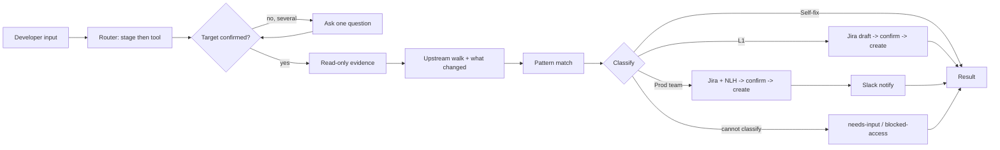

# TRIAGE-X

AI skill for developer self-service triage across the DevOps lifecycle. Auto-detects the failing stage, environment, cluster and namespace from pipeline logs and CI/CD config (including KITT), gives evidence-backed fixes, raises Jira tickets via Jira MCP (only if needed), prepares a Next Level Handover for production-team escalation, and produces a self-service RCA for the developer.

TRIAGE-X is an AI skill that helps a developer investigate a failed build, quality gate, publish, pipeline or deployment **before** raising a support ticket, and that makes sure any ticket it does raise arrives with complete, sanitized evidence.

> Status: `v0.1.0-pilot` scaffold. Organization-specific details are marked `TODO(owner)`. All examples are synthetic.

---

## 1. Problem and users

Today application teams raise delivery issues to L1 support engineers, who then work out by hand:

- which lifecycle stage, tool or pipeline step failed;
- which application, environment, cluster and namespace are affected;
- what changed recently and which logs and configuration matter;
- whether the developer can fix it, or whether L1 or a production engineering team must act.

| User | What TRIAGE-X gives them |
|---|---|
| **Developer** | A fast, evidence-backed answer: what failed, the likely cause, and the steps they can take themselves. |
| **L1 support** | Tickets that already contain the stage, target, sanitized evidence, checks done and unknowns. |
| **Production team** | A Next Level Handover (NLH) with blast radius, timeline and a specific ask, only when evidence shows L1 cannot resolve it. |

## 2. How it works (plain language)

1. You give TRIAGE-X a build or pipeline reference, a PR, a repository name, or an error message.
2. It works out which **lifecycle stage** the failure belongs to and which tool **reported** it.
3. It gathers context through authorized, **read-only** integrations.
4. It walks **upstream** to find the **first failing stage**, because the tool that shows the error is often only a downstream symptom.
5. It asks **"what changed?"**: commits, merged PRs, KITT or deployment config, image tags, dependencies.
6. It matches the evidence against documented failure patterns and decides:
   - **Self-fix**: steps you can take, with how to verify them;
   - **L1 issue**: a PGPTOOLS Jira ticket (after you confirm the draft);
   - **Prod team needed**: a PGPTOOLS ticket, an NLH, and a Slack notification (after you confirm).
7. It returns a **standard result** with both a readable summary and a machine-readable block, plus a short **self-service RCA** (problem, trigger, root cause, why it was not caught earlier, prevention) for every completed triage.
8. The support team decides manually whether to move a ticket to STRCONTAIN. **TRIAGE-X never does.**

## 3. Lifecycle stage map

| # | Stage (id) | Tools | Typical failure categories |
|---|---|---|---|
| 1 | Source & change (`source-change`) | GitHub | Branch protection, required checks, merge conflicts, workflow or config errors |
| 2 | CI build (`ci-build`) | Jenkins, Docker (build) | Compilation, dependency resolution, build agent, Dockerfile, test failures |
| 3 | Quality & security (`quality-security`) | SonarQube, Gates | Quality gate conditions, scan failures, policy violations |
| 4 | Package & publish (`package-publish`) | Artifactory, Docker (registry) | Publish or pull, version, permission, storage errors |
| 5 | Orchestrate & deliver (`orchestrate-deliver`) | Concord | Pipeline flow, task failures, target resolution, approvals |
| 6 | Deploy (`deploy`) | Kubernetes, CD Orchestration tools (AKS, GKE, EKS) | Manifest or config errors, image pull, rollout, quota, admission policy |
| 7 | Run & operate (`run-operate`) | Kubernetes, CD Orchestration tools (AKS, GKE, EKS) | CrashLoop, OOM, probes, scheduling, node or platform health |

Failure categories: `code-change` · `configuration` · `dependency` · `credentials-access` · `policy-gate` · `capacity-quota` · `platform-infra` · `transient-flaky` · `unknown`.

## 4. Tool scope

| Tool | Stage(s) | Module | Pilot (v0.1.0) |
|---|---|---|---|
| GitHub | 1 | `tools/github/` | Supporting context (KITT files, changes) |
| Jenkins | 2 | `tools/jenkins/` | **Primary** |
| Concord | 5 | `tools/concord/` | Supporting context |
| Gates | 3 | `tools/gates/` | Post-pilot |
| SonarQube | 3 | `tools/sonarqube/` | **Primary** |
| Artifactory | 4 | `tools/artifactory/` | Post-pilot |
| Docker | 2, 4 | `tools/docker/` | Post-pilot |
| Kubernetes | 6, 7 | `tools/kubernetes/` | Post-pilot (the CD Orchestration tools (AKS, GKE, EKS) module covers pilot runtime cases) |
| CD Orchestration tools (AKS, GKE, EKS) | 6, 7 | `tools/cd-orchestration/` | **Primary** |

These modules describe **what to investigate**. They do not claim that any particular internal API or connector exists; connector details are `TODO(owner)` in each `context.md`.

## 5. Investigation and escalation flow



A full architecture diagram is in `docs/architecture.md`.

## 6. Output contract (summary)

Every triage returns two parts, defined in `core/output-contract.md`:

1. **Human-readable result** beginning `TRIAGE-X Result · <triage-id>`, with stage, reporting tool, likely failing tool, category, target, blast radius, evidence (facts and hypotheses), what changed, likely cause, confidence, classification, status, actions taken and proposed manual actions.
2. **Machine-readable `triage_result`** in YAML, validated by `schemas/triage-result.schema.json` (schema version `1.0`).
3. **Self-RCA** for completed triages (`core/self-rca.md`), also stored as `triage_result.rca`. It stays a `draft` until the developer confirms the fix worked.

## 7. Runtime permissions

TRIAGE-X investigates **read-only**. It never changes clusters, workloads, pipelines, repositories, images, artifacts, configuration or access; never restarts, rebuilds, redeploys or rolls back; never executes a fix; and never moves a ticket to STRCONTAIN.

The only runtime writes, each **after the developer confirms the draft**:

1. Create a PGPTOOLS Jira issue through the existing Jira MCP (`integrations/jira-mcp.md`).
2. Post a Prod-team notification to `#triage-x-alerts` (`integrations/slack.md`).

Whether confirmation can ever be skipped is `TODO(owner)`. Prompt instructions are **not** a security boundary: permissions must be enforced by the integrations and platform configuration (`core/security-and-privacy.md`).

## 8. Setup and validation

Requirements: Python 3.10+.

```bash
python3 -m venv .venv
. .venv/bin/activate
pip install -r tests/requirements.txt
python3 tests/validate.py
```

`tests/validate.py` checks:

- the repository structure in this README exists;
- every tool module has `context.md`, `checks.md` and `runbooks.md`, each with required sections, and every runbook has 5–8 complete failure patterns;
- every file in `examples/expected-outputs/` validates against the schema and every input has a matching expected output;
- every tool has at least four evaluation cases in `tests/cases/` and all cross-cutting cases are present and complete;
- no real-looking URLs, hostnames, IPs, e-mail addresses or secret-like strings appear in the repository.

It does **not** run behavioral evaluation (asking the model to triage the cases and scoring the answers). That needs the in-house skill platform and the real integrations; see `docs/evaluation-and-improvement.md`.

To install the skill, load `SKILL.md` plus the `core/`, `tools/` and `integrations/` files into the skill platform. The exact packaging is `TODO(owner)`.

## 9. Repository layout

```text
SKILL.md                 Skill entry point (workflow and guardrails)
core/                    Router, stages, classification, contract, evidence, security, NLH, Self-RCA
schemas/                 JSON Schema for triage_result
tools/<tool>/            context.md, checks.md, runbooks.md per tool (+ _template)
integrations/            Jira MCP and Slack contracts
examples/inputs/         Synthetic developer inputs (incl. KITT-style sample)
examples/expected-outputs/  Expected triage results (schema-validated)
tests/cases/             Evaluation cases (per tool + cross-cutting)
tests/validate.py        Static validation
docs/                    Architecture, adding a tool, evaluation, USA integration
```

## 10. Known limitations

- No live integration has been verified; every connector detail is `TODO(owner)`.
- Log signatures and commands in tool modules are **illustrative** and must be checked against real tool output.
- KITT examples are illustrative, not an official schema.
- Confidence labels are qualitative, not calibrated probabilities.
- Behavioral accuracy is unmeasured until the evaluation suite runs on the skill platform.

## 11. Open decisions (`TODO(owner)`)

- Skill platform header format, size limits and tool bindings for `SKILL.md`.
- PGPTOOLS project mapping, issue types, required fields, components, priority mapping.
- Slack channel ID for `#triage-x-alerts`.
- Confirmation of default ownership heuristics.
- Environment naming conventions.
- Whether developer confirmation before ticket creation can be skipped.
- Unified Support Agent integration (`docs/usa-integration.md`).
- Internal endpoints and connector details for every tool.

## 12. Rollout plan

| Phase | Scope | Writes |
|---|---|---|
| `v0.1.0-pilot` shadow | Jenkins, SonarQube, CD Orchestration tools (AKS, GKE, EKS) primary; Concord and GitHub (KITT) supporting | None; drafts only |
| `v0.1.0-pilot` writes on | Same | Jira and Slack after integrations are configured and verified |
| `v1.0.0` | All tools | After pilot findings, integration checks and evaluation results are reviewed |

## 13. Success measures

Defined in full, with denominators and methods, in `docs/evaluation-and-improvement.md`:

- cases resolved without a ticket (suggested self-fix vs developer-confirmed resolution);
- time from request to a useful triage result;
- tickets arriving with all required context;
- stage, tool and classification accuracy against reviewed cases;
- incorrect self-fix recommendations;
- unnecessary or unsupported prod-team escalations;
- duplicate ticket rate and integration failures;
- optional: contribution to restore time, reported beside DORA-style metrics without claiming causation.

No baselines or targets are set yet. Targets will be proposed after baseline measurement in the pilot.
