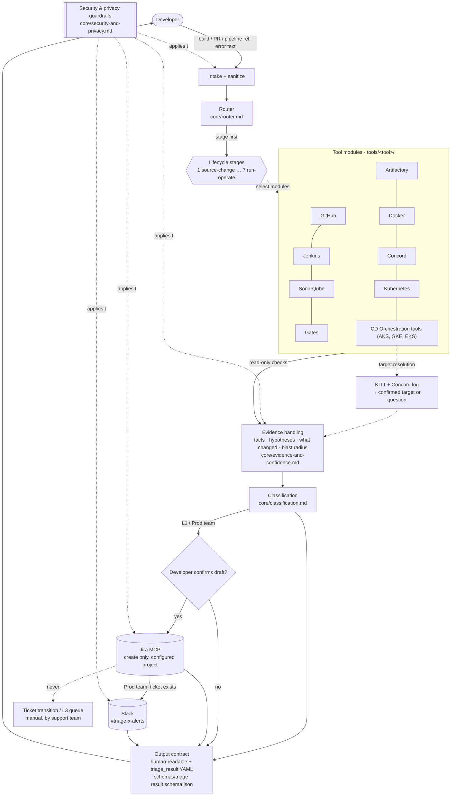

# Architecture

## 1. Overview

## 2. Components

| Component | Location | Responsibility | Depends on |
|---|---|---|---|
| Skill entry | `SKILL.md` | Ordered workflow, guardrails | core, tools, integrations |
| Router | `core/router.md` | Stage then tool selection | lifecycle-stages |
| Lifecycle model | `core/lifecycle-stages.md` | Stages, categories, upstream walk | none |
| Evidence | `core/evidence-and-confidence.md` | Fact/hypothesis, changes, blast radius, confidence | none |
| Classification | `core/classification.md` | Self-fix / L1 / Prod team / status | evidence |
| Output contract | `core/output-contract.md` + schema | Stable result format | none |
| Tool modules | `tools/<tool>/` | Tool-specific context, checks, patterns | lifecycle ids, categories |
| Integrations | `integrations/` | Jira and Slack contracts | output contract |

## 3. Decoupling rules

1. **Core never names tool internals.** Core files refer to stages and categories, not to specific tool APIs.
2. **Tool modules never define classification rules.** They state an *expected* classification per pattern, using the vocabulary in `core/`.
3. **Integrations consume only the output contract.** Jira and Slack content is derived from `triage_result`, so swapping an integration does not change triage logic.
4. **The output contract is versioned** (`schema_version`). Additive changes only within a major version.
5. **Connectors are configuration**, recorded as `TODO(owner)` in each tool's `context.md`, not baked into reasoning.

## 4. Unified Support Agent boundary

Whether TRIAGE-X becomes part of a Unified Support Agent (USA) is **`TODO(owner)`**. The intended boundary, if it does:

- USA owns user conversation, routing between skills, and identity.
- TRIAGE-X owns delivery-failure triage and returns `triage_result`.
- Ticket and Slack writes stay behind the same confirmation and permission rules, wherever they are executed.

Details: `usa-integration.md`.

## 5. Adding a tool

A new tool needs a new `tools/<tool>/` directory, a router hint, an enum entry in the schema, and evaluation cases. Nothing else changes. See `adding-a-tool.md`.
