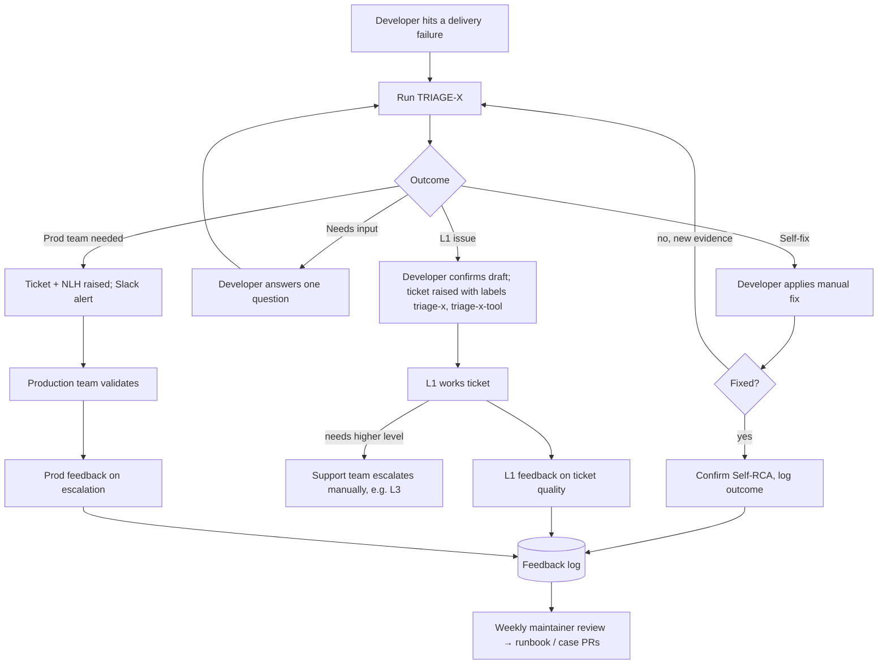

# Operating process

How TRIAGE-X fits into the current support flow. Names of teams, queues and SLAs are `TODO(owner)` placeholders for each organization to fill in.

## 1. Roles

| Role | Responsibility |
|---|---|
| **Developer** | Runs TRIAGE-X first. Performs Self-fix steps. Reviews and confirms any ticket draft. Records the outcome. |
| **TRIAGE-X** | Triages from evidence, classifies, drafts tickets, NLH and Self-RCA. Read-only; never moves tickets. |
| **L1 support** (`TODO(owner)`: team name) | Works tickets labelled `triage-x`. Gives feedback on ticket quality. Decides on further escalation. |
| **Production team** (`TODO(owner)`) | Works Prod-team tickets with an NLH. Gives feedback on escalation quality. |
| **TRIAGE-X maintainers** (`TODO(owner)`) | Review feedback weekly, update runbooks and evaluation cases through reviewed PRs, run `tests/validate.py`. |
| **Tool owners** (one per tool module) | Review and correct their tool's runbook, signatures and checks. |

## 2. Flow

## 3. Rules of engagement

1. Developers run TRIAGE-X **before** raising a ticket for supported tools.
2. A ticket raised from TRIAGE-X keeps the generated body, including evidence, checks done, unknowns, triage ID and Self-RCA.
3. L1 must not be asked to re-collect evidence that the ticket already contains. If evidence is missing, L1 records that as feedback.
4. Escalation beyond L1 (for example to L3) is always a support-team decision. TRIAGE-X never does it.
5. Production incidents follow the existing incident process (`TODO(owner)`); TRIAGE-X does not replace it.
6. Out-of-scope tools go to the normal support route (`TODO(owner)`).

## 4. Service levels

| Item | Target |
|---|---|
| Time to first triage result | Measure in the pilot; no target until a baseline exists |
| L1 first response to a `triage-x` ticket | `TODO(owner)`: existing L1 SLA applies |
| Prod-team acknowledgement of an NLH | `TODO(owner)` |

## 5. Feedback log

Record one row per triage (a spreadsheet or a Jira field set is fine; location `TODO(owner)`). No logs or secrets in the log.

| Field | Example |
|---|---|
| Triage ID | TX-20261031-0001 |
| Date | 2026-10-31 |
| Team / app | example-team / example-app |
| Primary tool | sonarqube |
| TRIAGE-X classification | self-fix |
| Confidence | high |
| Developer outcome | resolved without ticket / ticket raised / still open |
| Ticket key (if any) | EXAMPLE-1001 |
| Reviewed classification (L1 or maintainer) | self-fix |
| Stage and tool correct? | yes / no |
| Evidence complete in ticket? | yes / no / n/a |
| Notes | free text, sanitized |

These rows feed the metrics in `docs/evaluation-and-improvement.md`.

## 6. Weekly maintainer review

1. Review new feedback rows where the reviewed classification differs, the stage/tool was wrong, or the ticket lacked evidence.
2. For each, add or fix a runbook pattern and add an evaluation case (synthetic, sanitized).
3. Run `python3 tests/validate.py`; merge through review by CODEOWNERS.
4. Rebuild the bundle (`python3 scripts/bundle.py`) and redeploy the skill.
5. Track the metrics trend; propose targets only after the pilot baseline.
